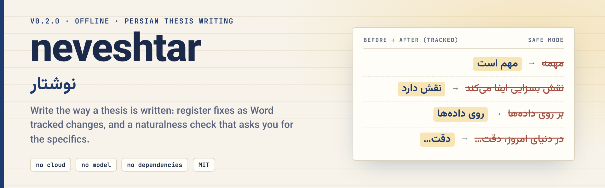

<div align="center">

<picture>
  <source media="(prefers-color-scheme: dark)" srcset="assets/banner-dark.png">
  
</picture>

**English** · [فارسی](README.fa.md) · [🌐 Live demo](https://mrzroot.github.io/neveshtar/) · [📦 Release v0.2.0](https://github.com/mrzroot/neveshtar/releases/tag/v0.2.0) · [🗒 Changelog](CHANGELOG.md)

     

</div>

> **neveshtar** (نوشتار, "the written word") is an offline, rule-based aid for Persian thesis prose: it moves spoken forms to written ones as Word **tracked changes**, and (new in 0.2) it points out **stiff, template-like phrasing** and asks you for the specifics only you have.

**Contents:** [Why](#-why) · [Install](#-install) · [Quick start](#-quick-start) · [Before / after](#-before--after) · [Features](#-features) · [Rules](#-rules-and-finding-codes) · [How it works](#-how-it-works) · [Limits & honesty](#-limits--honesty) · [Roadmap](#-roadmap) · [Contributing](#-contributing) · [License](#-license)

## 🎯 Why

A first draft is typed the way we speak (`داره`, `میشه`, `بخاطر`), and a machine-assisted draft often has the opposite problem: correct but stiff. «در دنیای امروز، … نقش بسزایی ایفا می‌کند. همچنین … علاوه بر این …» A reader sees the template, not the thesis.

`neveshtar` keeps two things visible. **Register:** some spoken forms have exactly one written form («دارد», «می‌شود») and are safe to fix mechanically; others depend on context and stay *suggestions*. **Naturalness:** a filler opener can be trimmed safely, but whether «نقش مهمی دارد» means anything is something only you can answer, so the tool **asks a question instead of inventing a claim**. Every finding has a location, a reason in two languages, a confidence tier and, where it can, a rewrite. `safe` mode (the default) applies only the unambiguous ones, and the result is a Word tracked change you accept or reject one by one.

## 📦 Install

Python 3.9+, standard library only, no network. Tested on Linux only.

```sh
pipx install git+https://github.com/mrzroot/neveshtar        # PyPI release not published yet
uvx --from git+https://github.com/mrzroot/neveshtar neveshtar demo
pip install -e .                                             # from a clone
```

## 🚀 Quick start

```sh
neveshtar sample draft.txt --natural     # an invented, formal-but-stiff draft to try it on
neveshtar natural draft.txt              # naturalness check + rhythm report
neveshtar natural draft.docx --fix       # copy with tracked changes (safe trims) and Word comments for the open questions
neveshtar chapter.docx                   # register check (spoken → written), as in 0.1
neveshtar rhythm draft.txt               # plain sentence-length / opener numbers only
```

Real output (excerpt; the sample text is invented, full output in [docs/natural-demo.txt](docs/natural-demo.txt)):

```text
$ neveshtar natural draft.txt
neveshtar 0.2.0 · draft.txt · 10 paragraphs · mode safe · naturalness

Writing-quality aid: you review every suggestion. It makes no claim about AI detectors and is not built to
evade them or to hide who wrote a text; you remain responsible for the text and for your university's rules
on AI assistance and disclosure.

line 3
  ! R101  ⁧در دنیای پرشتاب امروز،⁩  →  (drop it)   [high · applied by this mode]
  ! R102  ⁧نقش بسزایی ایفا می‌کنند⁩  →  ⁧نقش دارند⁩   [medium · rewrite suggested]
       ask: What exactly does it do: which effect, on what, shown by which result or source?
  ! R104  ⁧علاوه بر این⁩   [medium · for you to decide]
       why: Sentence after sentence opens with a connector, so the links sound mechanical rather than argued.
  · R302  ⁧یکی از مهم‌ترین⁩   [low · for you to decide]
       ask: Add one of: a number, a citation, your own observation or decision, a named example.
[…]
Rhythm and readability (plain numbers, not a score)
  sentences            34
  words per sentence   mean 7.9 · median 9.0 · min 3 · max 15 · variation 0.39
  opener diversity     0.65   (1.0 = every sentence opens differently)
  connector openers    15% of sentences   three-item lists 12%   passive sentences 38%
[…]
0 error(s), 13 warning(s), 11 note(s); 3 rewrite(s) would be applied in mode safe.
```

Library: `from neveshtar import engine; engine.formalize("این مهمه", mode="safe")` → `'این مهم است'`.

## ✍️ Before / after

Real output on an invented two-sentence sample (`neveshtar natural --fix`, with and without `--mode balanced`):

| | text |
|---|---|
| **Draft** | <div dir="rtl">در دنیای پرشتاب امروز، کتابخانه‌های دانشگاهی نقش بسزایی ایفا می‌کنند. همچنین فناوری‌های نوین نقش مهمی در دسترسی به منابع دارند.</div> |
| **`--fix` (safe)** | <div dir="rtl">کتابخانه‌های دانشگاهی نقش بسزایی ایفا می‌کنند. همچنین فناوری‌های نوین نقش مهمی در دسترسی به منابع دارند.</div> |
| **`--fix --mode balanced`** | <div dir="rtl">کتابخانه‌های دانشگاهی نقش دارند. همچنین فناوری‌های نوین نقش مهمی در دسترسی به منابع دارند.</div> |
| **Still open (as questions)** | which effect, on what, shown by which result? · is «همچنین» adding anything? · add a number, a source or a named case |

The tool never writes the number or the claim: that part is yours. It trims what is safe to trim, suggests a plainer phrase and asks the question a careful reader would ask. Rhythm numbers for this sample: both sentences are 10 words long (variation 0.0), and one of the two sentences opens with a connector.

## 🧩 Features

| | |
|---|---|
| 🔁 **Register rewrites** | ~1,300 spoken forms → written, each with reason (EN + FA), tier and alternatives |
| 🪶 **Naturalness check** *(0.2)* | 11 checks (R-codes): stock openers, stock phrases, empty intensifiers, stacked connectors, uniform rhythm, repeated frames, triplets, vague generalities, English calques, nominalisation, passive pile-ups |
| ❓ **Questions, not inventions** | for anything that needs your data, citation or decision it asks; it never fills in a number |
| 🛡 **Safe mode** | applies only `high`-confidence, unambiguous trims; everything else stays a suggestion |
| 📝 **Word output** | real tracked changes (accept/reject each) plus **Word comments** holding the open questions *(0.2)*; "reject all" restores your text exactly |
| 🌐 **HTML diff** | one self-contained file: before / after / diff toggle, hover for the reason |
| 📊 **Rhythm report** *(0.2)* | sentence-length variation, opener diversity, connector / triplet / passive share: plain numbers, no score, no verdict |
| 🧱 **Scaffolds** | fill-in-the-blank frames for abstract, introduction, method, results… (guidance, not text) |
| 🔌 **CLI + `--json`** | `--strict`, `--skip CODES`, `--mode`, exit codes for scripts |
| 🔒 **Offline** | no cloud, no model, no telemetry, no dependencies |

## 🔎 Rules and finding codes

**Naturalness checks (R-codes, `neveshtar natural`)**

| code | what it finds | what you get |
|---|---|---|
| R101 | stock opener («در دنیای امروز»، «لازم به ذکر است که»، «همان‌طور که می‌دانیم») | trim (`high`, applied in `safe`); softer openers («امروزه»، «در سال‌های اخیر») are a question |
| R102 | stock phrase («نقش بسزایی ایفا می‌کند»، «گام مهمی»، «حائز اهمیت») | rewrite («نقش دارد») or a question: which effect, on what? |
| R103 | empty intensifier («بسیار بسیار» is trimmed in `safe`; «بسیار حیاتی», «فوق‌العاده») | trim, or "how much? a number or a comparison?" |
| R104 | sentence after sentence opening with a connector («همچنین»، «علاوه بر این»، «بنابراین») | a question: name the relation once, or let the order carry it |
| R201 | uniform sentence length across a paragraph | a question (read aloud; vary the length) |
| R202 | the same opener or sentence frame again and again | a question (rebuild around what differs) |
| R301 | many «الف، ب و ج» triplets | a question (are all three equal?) |
| R302 | sweeping statement with no number, citation, quotation or named case | "add one of: number, citation, observation, example" |
| R401 | English calques («بر روی»، «در رابطه با»، «ما می‌توانیم نتیجه بگیریم که») | rewrite, `medium` |
| R501 | verbal noun + light verb («مورد بررسی قرار گرفت» → «بررسی شد») | rewrite (`medium`), or a question |
| R601 | several passives in a row | a question (does the actor matter? passive is normal in a methods section) |

<details>
<summary><b>Register codes (N-codes) and style checks (S-codes)</b></summary>

| code | meaning | applied by |
|---|---|---|
| N101 | spoken word (`خیلی`, `الان`, `یه`, `تو`) | `safe` if high |
| N102 | spoken verb form (`می‌خوام`, `میاد`, `نمی‌تونن`; about 1,000 generated forms) | `safe` if high |
| N103 | spoken copula (`مهمه` → `مهم است`) | `safe` |
| N104 | object marker and clitic pronouns (`رو`, `اینو`, `ازش`) | `safe` for `رو`, `اینو`; `بهش`, `ازش` are `low` |
| N105 | spoken phrase or connective (`اینجوری`, `چون که`, `ولی`) | tier varies |
| N106-N108 | slang, spoken demonstratives and plurals, spoken nouns (`خونه`, `زبون`) | tier varies |
| N201 | over-formal filler (`می‌باشد`, `گردید`, `جهت`): optional, never in `safe` / `balanced` | `all` |
| S101-S103 | first person «من / ما», direct address «شما» | report |
| S301, S302 | boosters (`قطعاً`) and three or more hedges in one sentence (after Hyland) | report |
| S401 | vague quantifier with no number or citation | report |
| S501, S601 | three openers repeated; sentence longer than `--max-words` (45) | report |
| S701, S902 | spoken and formal connectives mixed; sentence opened by `و` / `پس` / `چون` | report |
| S801 | claim cue (`طبق تحقیقات`) with no citation in the sentence | report |
| S901 | `!`, emoji, `؟؟` | report |

</details>

<details>
<summary><b>All commands and options</b></summary>

```sh
neveshtar chapter.docx                       # = neveshtar check; exit 1 only if there is a high-confidence spoken form
neveshtar check chapter.md --strict          # exit 1 on warnings too (for scripts / CI)
neveshtar check chapter.docx --natural       # register + style + naturalness in one run
neveshtar check chapter.docx --json          # machine-readable: code, text, suggestion, confidence, reason (en + fa), paragraph
neveshtar check chapter.docx --html r.html   # self-contained diff report
neveshtar fix chapter.docx                   # chapter.neveshtar.docx, SAFE mode, Word tracked changes
neveshtar fix chapter.docx --mode balanced   # also the likely ones (بخاطر → به دلیل)
neveshtar fix chapter.docx --clean           # apply silently instead of as tracked changes
neveshtar natural FILE [--mode safe|balanced|all] [--skip R104,R301] [--with-register] [--json] [--html OUT]
neveshtar natural FILE --fix [-o OUT] [--no-comments] [--clean]
neveshtar rhythm FILE [--json]
neveshtar scaffold method --lang both        # fill-in-the-blank frame
neveshtar rules                              # every category and check
neveshtar demo                               # synthetic draft, offline
```

</details>

## ⚙️ How it works

1. The text is split into paragraphs (`.docx` body incl. table cells; `.txt`/`.md` lines) and sentences. Quotations (`«…»`, `"…"`), code and URLs are **protected** and never rewritten.
2. Hand-written patterns and counts run over each paragraph and over the whole text (repeated frames need more than one sentence). Every pattern is a readable regex or a small word list in `natural.py`, `lexicon.py` and `style.py`; there is no model.
3. Each finding gets a tier: **high** = one written form or an unambiguous trim; **medium** = very likely but context decides; **low** = a taste, or only you can answer. `safe` applies *high*, `balanced` adds *medium*, `all` adds *low*.
4. `.docx` output edits **inside plain text runs only** (formatting is inherited); fields, tabs, images, content controls and paragraphs that already hold tracked changes are skipped and reported. Open questions become Word comments anchored to the paragraph. The input is never overwritten and the copy is re-checked.

## 🧭 Limits & honesty

- **A writing-quality aid whose rewrites you review.** It does not claim, test or promise that any text will pass an AI detector, it is **not built to evade detectors or to hide who wrote a text**, and it has no "detector score". You remain responsible for your text and for following your university's rules on AI assistance and disclosure.
- **Not an author.** It never writes your content, numbers or citations. Zero findings does not mean good writing.
- **Heuristics, not understanding.** About 1,300 spoken forms and a few dozen naturalness patterns, no morphological analyser, no context model. A phrase it does not list is not flagged; a stock phrase used on purpose is still flagged (skip it with `--skip`). There is no accuracy benchmark; the tests check the rules, not Persian in general.
- **The rhythm numbers are descriptive.** They show patterns; they are not a verdict on style or on who wrote the text.
- **Not a spell or grammar checker.** Typing slips (ZWNJ, Arabic ي/ك) are [payanlint](https://github.com/mrzroot/payanlint)'s job.
- **I have not opened any output in Microsoft Word.** Tracked changes and comments were produced from the OOXML structure and checked with python-docx and by reading the XML back; Word and Word for Mac behaviour is reasoned, not observed.
- Linux only tested. Only the main body of the `.docx` is read (no footnotes, headers, footers, text boxes). Persian only.

Everything in `neveshtar.sample`, the tests and this README is invented; no real thesis was used. See [NOVELTY.md](NOVELTY.md) for what already exists.

## 🗺 Roadmap

- [ ] Open the `.docx` output in real Word / LibreOffice and record what is observed
- [ ] More patterns for calques and nominalisation, from reports of real false negatives
- [ ] Footnotes and headers in `.docx`
- [ ] A small, hand-labelled evaluation set (invented or consented text only)

## 🤝 Contributing

Standard library only, Python 3.9 must keep working, tests use invented fixtures. Read [CONTRIBUTING.md](CONTRIBUTING.md); issues and pull requests use the templates. Changes meant to evade AI detectors or hide authorship will not be merged. Cite: [CITATION.cff](CITATION.cff).

```sh
git clone https://github.com/mrzroot/neveshtar && cd neveshtar
pip install -e ".[test]" && pytest
```

Related: [payanlint](https://github.com/mrzroot/payanlint) (Word typing and formatting) · [vazhgun](https://github.com/mrzroot/vazhgun) (RTL and bidi in `.docx`) · [arjaa](https://github.com/mrzroot/arjaa) (citations and references)

## 📄 License

MIT · Mohammadreza Zare
